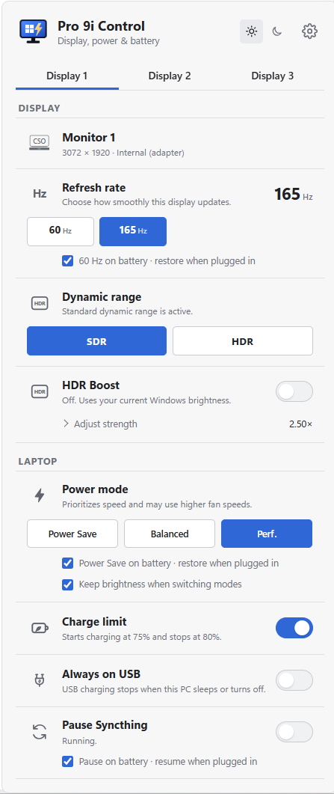

# Pro 9i Control

Pro 9i Control is a free Windows tray app for everyday display, power, and
battery controls on the Lenovo Yoga Pro 9i and similar compatible Lenovo laptops.
It is a personal-use customization of
[WinDisplay](https://github.com/zpix1/windisplay), maintained by
[@clearfeather](https://github.com/clearfeather).



**Personal use only — project intent:** this community project is intended for
individuals managing their own laptops. It is not an official Lenovo product and
is not endorsed by Lenovo or the original WinDisplay contributors. This wording
does not replace third-party licenses or restrict rights those licenses grant.
See [Licensing status](LICENSE.md) and [Third-party credits](THIRD_PARTY_NOTICES.md).

## Supported hardware

Development and local checks have focused on the Lenovo Yoga Pro 9i, model
**83BV**, running Windows. Similar Lenovo laptops may expose some controls when
their firmware and installed Lenovo services support them; compatibility is not
guaranteed. HDR Boost is specifically gated to the supported built-in mini-LED
panel. External displays and other laptops do not automatically gain that feature.

## Features

- Select a supported refresh rate for the display's current resolution.
- Switch a compatible display between SDR and HDR.
- Apply HDR desktop boost at 60 Hz, restoring the previous HDR and refresh rate when stopped.
- Switch supported Lenovo laptops between Power Save, Balanced, and Performance modes.
- Limit charging to 75–80% with Lenovo Conservation Mode on supported laptops.
- Toggle Lenovo Always on USB charging on supported laptops.
- Pause Syncthing scanning and syncing manually or automatically on battery.
- Optionally switch the built-in screen to 60 Hz and Lenovo power mode to Power Save on battery.
- Start automatically with Windows and remain available in the tray.
- Customize the panel with saved visibility preferences for display and laptop controls.

The interface supports multiple monitors and can switch Windows and the app
between Light and Dark appearance modes.

## Customize the interface

Click the **settings gear** in the top-right corner to choose which controls
appear. Each choice applies immediately and is saved between launches.
The existing panel is kept on upgrade; additional display controls start hidden.

- **Display:** display details, refresh rate, dynamic range, HDR Boost,
  brightness, resolution, scale, orientation, input source, display power,
  and display identification.
- **Laptop:** power mode, charge limit, Always on USB, and Syncthing.
- **Show all**, **Hide all**, and **Restore defaults** provide quick layout choices.
- **Window behavior** controls hiding on focus loss and startup notifications.
  **Brightness shortcuts** offers Windows behavior or F14/F15 control of all displays.
  Restart the app after changing the brightness shortcut preference.

Some controls require compatible hardware. Hiding a control changes only its
visibility: battery and Syncthing automation keep their existing preferences.
Active HDR Boost retains its stop and recovery controls until the session ends.
The settings gear remains available even when every control is hidden.
Use **Done**, the gear, or Escape to return to the panel.

See [HDR_BOOST.md](HDR_BOOST.md) for HDR Boost usage, recovery,
bounded checks, and the visual confirmation still required.

The Charge limit control dynamically uses Lenovo's installed
`PowerBattery.dll`; the Lenovo library is not bundled with Pro 9i Control. On unsupported
computers, or when Lenovo Vantage Service's IdeaNotebook component is missing,
the control is shown as unavailable.

The Power mode control reads Lenovo's current Intelligent Thermal Solution
state and offers Power Save, Balanced (Intelligent Cooling), and Performance,
in that order. Modes that the laptop does not advertise are disabled.

The Always on USB control uses Lenovo's installed `PowerBattery.dll` and
follows the capability and current state reported by the laptop firmware.

## Automatic battery settings

Refresh rate and Power mode each have an independent checkbox, enabled by
default, matching the Syncthing battery option:

- **60 Hz on battery** changes only the built-in laptop screen's refresh rate.
- **Power Save on battery** selects the Lenovo Power Save mode.

When plugged in, each control restores the setting it changed. A manual choice
made on battery is respected until the next power-source change or app restart;
the app also preserves manual changes made outside its panel. Turning off a
checkbox restores the previous setting if the automatic setting is still active.
External displays are unaffected by the refresh-rate checkbox.

These controls run with the panel closed and check power at startup and after
waking. HDR Boost retains control of its required 60-Hz timing while active;
any pending automatic refresh change or restoration waits until boost finishes.
Saved recovery data survives an interrupted exit. Normal exit restores settings
changed by the battery controls after HDR Boost has finished restoring its session.

**Keep brightness when switching modes**, under Power mode, is enabled by
default. It remembers the current panel brightness percentage before a manual
or automatic Lenovo mode switch made by Pro 9i Control, then restores it after the mode
settles. A brief dip can still be visible during the switch. It does not lock
the brightness keys or change Windows Energy Saver settings. If brightness
cannot be read or restored, the power mode still changes and the control shows
a message. Turning the checkbox off keeps Lenovo's normal brightness behavior.

## Syncthing battery control

The Laptop section includes a **Pause Syncthing** switch and a **Pause on
battery · resume when plugged in** option, enabled by default. The app detects
Syncthing's local configuration and uses its local API. Syncthing must already
be installed and running; its API key stays in the Rust backend.

Automatic pausing runs in the background with the panel closed, checks power
at startup and after waking, and reacts to charger changes. It pauses folders,
which stops both scanning and syncing. When plugged in, it resumes only the
folders Pro 9i Control paused. Folders already paused in Syncthing stay paused.

You can turn the pause switch off while on battery to resume until the power
source changes or Pro 9i Control restarts. A manual pause stays active across
charger changes until you turn it off. Turning off automatic pausing releases
automatic pauses while preserving a manual pause.

The controller retries every 30 seconds if Syncthing is unavailable and checks
for newly added folders. Preferences and pause ownership are saved separately
in the app data directory's `syncthing.json`. Normal app exit releases its
pauses; after an interrupted exit, the next launch recovers using that file.
The `preview` command leaves Syncthing unchanged.

## Windows build prerequisites

Install the following once:

1. Microsoft Visual Studio Build Tools with the **Desktop development with
   C++** workload and a Windows 10 or 11 SDK.
2. Rust through `rustup` using the default stable MSVC toolchain.
3. Node.js and pnpm.

Open a new PowerShell window after installing Rust, then verify:

```powershell
rustc --version
cargo --version
pnpm --version
```

## Build the installer and portable ZIP

From the project folder, run:

```powershell
.\scripts\build-windows.ps1
```

The script creates:

- `release\Pro_9i_Control_0.5.2_x64-setup.exe` — recommended NSIS installer.
- `release\Pro_9i_Control_0.5.2_windows_x64_portable.zip` — portable executable.

The portable build requires Microsoft Edge WebView2 on the target computer.
Modern Windows 10 and Windows 11 systems normally already include it.

## Development

The app uses a React/TypeScript frontend and a Tauri 2/Rust backend.

```powershell
pnpm install
pnpm run tauri dev
```

Building the Windows installer requires Node.js, Rust, and the Microsoft C++
build tools used by Tauri.

## Upstream and licensing note

Pro 9i Control is a customization of
[zpix1/windisplay](https://github.com/zpix1/windisplay), created from upstream
commit `f382b6920cdc8ababba812ef15ce1388fe474d0c`. WinDisplay's contributors retain
authorship of the original implementation.

Original WinDisplay contributors credited by upstream are
[Ivan Baksheev / @zpix1](https://github.com/zpix1),
[@exSnake](https://github.com/exSnake), and
[@Cesarsk](https://github.com/Cesarsk). The Lenovo-specific additions and other
changes are documented in [CHANGELOG.md](CHANGELOG.md).

WinDisplay did not include a license file at the base commit, and no applicable
upstream license was found when checked on November 6, 2026. Permission to
redistribute its derived portions remains unresolved. Publishing credits or
offering a free download does not establish permission from those rights holders.

The incorporated LumaLift-derived HDR Boost crate declares **GPL-3.0-only**.
Its existing notice is retained, and the full license is included in
[LICENSES/GPL-3.0-only.txt](LICENSES/GPL-3.0-only.txt). Personal-use intent does not
override GPL rights, including commercial-use and redistribution rights.
This repository does not claim a single blanket license for all its contents;
see [LICENSE.md](LICENSE.md) for the component-specific status.
